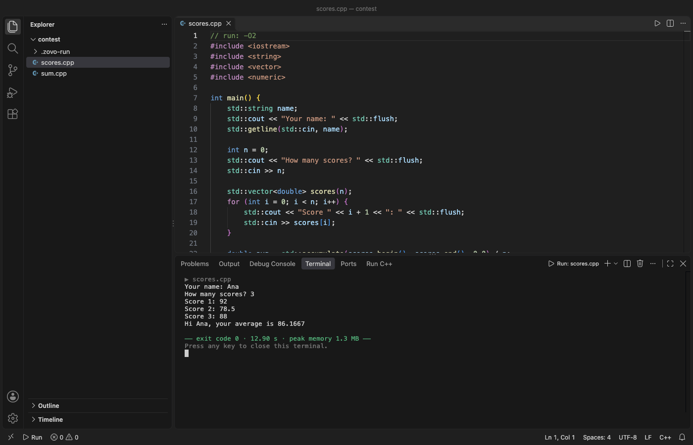
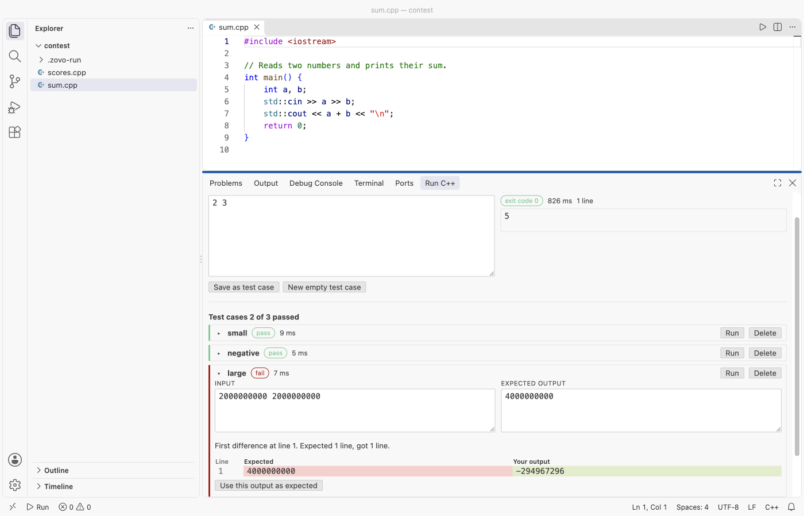

# Run C++ and C Code with One Click (GCC, G++, Clang)

Free, no sign-in, works offline. Click Run on a `.c` or `.cpp` file. The extension compiles it with the gcc, g++, clang or clang++ already on your computer and runs the program in the terminal, where `scanf` and `cin` work. Errors go to the Problems panel at the right line. An Input panel keeps test cases and shows pass or fail with a diff.



- The Run button in the editor title (or Ctrl+Alt+Enter, Cmd+Alt+Enter on Mac) builds and runs in one step. Build only, Run last build, Debug and Build all files in the folder are in the "..." menu.
- The Input & Tests panel takes pasted input and shows stdout, stderr, exit code, run time and peak memory. Test cases are saved per file and run together.
- A `// run: -O2 -lm` line at the top of a file sets flags for that file, and `// args: "Hello World" 3` sets the program arguments.
- Stop ends an endless loop and every process it started. A segfault shows the signal and what it usually means.
- Spaces, `&`, `ü` or `你好` in folder and file names work. No shell ever parses your paths.

## Why this one

The two most installed C/C++ run extensions on the Marketplace are good and popular. These are requests and bug reports from their issue trackers that this extension handles, each checked in a real VS Code run (see Tested):

| Request or report | Issue | Here |
|---|---|---|
| Compile flags for one source file, and the optimization level | [vscode-c-cpp-runner #135](https://github.com/franneck94/vscode-c-cpp-runner/issues/135), [#147](https://github.com/franneck94/vscode-c-cpp-runner/issues/147), [#183](https://github.com/franneck94/vscode-c-cpp-runner/issues/183) (open) | A `// run: -O2 -DFOO=7` line applies to that file only and comes after the defaults, so `-O2` wins over `-O0`. |
| Program arguments with spaces: "Hello World" became 2 arguments | [vscode-c-cpp-runner #157](https://github.com/franneck94/vscode-c-cpp-runner/issues/157) (open) | `// args: "Hello World" 2` gives `argc` 3 and `argv[1]` = `Hello World`. |
| Chinese folder names garbled in the Problems panel, so the error could not be clicked | [c-cpp-compile-run #377](https://github.com/danielpinto8zz6/c-cpp-compile-run/issues/377), [#402](https://github.com/danielpinto8zz6/c-cpp-compile-run/issues/402) | The compiler output is read as UTF-8 and every path is matched to the file that was compiled. A compile error in `my code/ü/你好.cpp` shows in Problems on the right file and line. |
| `*.cpp` wildcard fails with MSYS2 gcc on large projects | [vscode-c-cpp-runner #176](https://github.com/franneck94/vscode-c-cpp-runner/issues/176) (open) | Folder builds list each file by name. No wildcard, no shell. |
| Spaces or `&` in a path break the build | [vscode-c-cpp-runner #121](https://github.com/franneck94/vscode-c-cpp-runner/issues/121), [#76](https://github.com/franneck94/vscode-c-cpp-runner/issues/76), [c-cpp-compile-run #71](https://github.com/danielpinto8zz6/c-cpp-compile-run/issues/71) | Every argument goes to the compiler and to your program as a separate item, never through a shell. |
| Workspace settings overwritten | [vscode-c-cpp-runner #159](https://github.com/franneck94/vscode-c-cpp-runner/issues/159) | This extension never writes your settings files. Debug adds one entry to `launch.json`, and only when you press Debug. |
| One button to compile and run | [vscode-c-cpp-runner #170](https://github.com/franneck94/vscode-c-cpp-runner/issues/170) (open) | Run builds and runs. Build only is in the "..." menu. |

## Run a file

1. Open a `.c`, `.cpp`, `.cc` or `.cxx` file.
2. Click the Run button (top right), press Ctrl+Alt+Enter (Cmd+Alt+Enter on Mac), or right-click and pick Run C/C++ File.
3. The program runs in a terminal named "Run: file.cpp". Type its input there. At the end you see the exit code, the run time and the peak memory.

The program runs with the terminal as its console, so prompts without a newline show up before `cin` waits, as in any shell. While it runs, the Run button turns into Stop.

The keybinding is not used by VS Code or by the two most installed runners (they use F5 to F8, Ctrl+6, Ctrl+Alt+R/B/D/A). Change it in Keyboard Shortcuts: "Run C++: Run C/C++ File".

## Input & Tests panel

Open it with Run C++: Run with Input & Test Cases, or from the Run C++ tab in the bottom panel.



- Type the input and press Run with input (Ctrl+Enter in the input box).
- Save as test case stores the input and the current output as the expected output. Edit the expected output if it is wrong.
- Run all tests runs each case with a time limit (10 s, setting `zovoRun.timeLimitSeconds`) and shows pass or fail. A failed case shows a side-by-side line diff from the first difference.
- Compare modes: ignore spaces at line ends (default), exact, or words only (`zovoRun.compareMode`).
- Test cases live in `.zovo-run/tests/` in your workspace, one JSON file per source file, so you can commit them.

## Flags and arguments per file

```c
// run: -O2 -lm util.c
// args: "Hello World" 3
```

`run:` adds compiler flags (and extra source files) for this file. `args:` sets the program arguments; quotes keep spaces together. Both are read from the first 40 lines. The defaults are `-std=c++20 -Wall -Wextra -g -O0` for C++ and `-std=c17 -Wall -Wextra -g -O0` for C (settings `zovoRun.cppFlags`, `zovoRun.cFlags`). C programs are linked with `-lm`. If the compiler is too old for C++20 or C17, the build steps down to the newest standard it knows and says so.

## Errors and warnings

Compiler errors and warnings from gcc and clang go to the Problems panel with file, line and column, and notes are attached to their error. Linker errors (for example `undefined reference to sqrt`) show on the file with a hint (`-lm`, or build the whole folder). The full compiler output is in the "Run C++ and C" output channel.

## Large output, endless loops, crashes

- A program that prints 1,000,000 lines does not freeze the editor. In the Input panel the first 2,000 lines are shown, all lines are counted, and Open full output opens everything in an editor tab. Output past 32 MB is counted, not kept (`zovoRun.maxCapturedOutputMB`).
- Stop kills the program and every process it started (fork, child programs).
- A crash shows the signal and what it usually means, for example "SIGSEGV (signal 11): the program read or wrote memory it does not own". On Windows, codes like 0xC0000005 are named too.

## Compilers

gcc, g++, clang and clang++ are found on PATH. On Windows the extension also looks in `C:\msys64\ucrt64\bin`, `C:\msys64\mingw64\bin`, `C:\msys64\clang64\bin`, `C:\MinGW\bin`, `C:\mingw64\bin`, the WinLibs winget folder, TDM-GCC, Chocolatey MinGW, Scoop and `C:\Program Files\LLVM\bin`. Homebrew names like `g++-14` are found too. Run C++: Pick Compiler lists what was found, with versions.

When there is no compiler, a setup page shows the official steps for your system (Xcode Command Line Tools, MSYS2 or WinLibs, your Linux package manager) and a Check again button. The extension never downloads a compiler.

## Debug

Run C++: Debug C/C++ File builds with `-g` and starts the debugger with CodeLLDB or the C/C++ extension (gdb or lldb), whichever is installed. It adds one entry named "Debug file.cpp (Run C++)" to `.vscode/launch.json` (turn off with `zovoRun.writeLaunchJson`).

## Built programs

Programs go to `.zovo-run/bin/` in the workspace folder, with a `.gitignore` inside so git skips them, or to the system temp folder (`zovoRun.outputFolder`). A file is built again only when it, a header next to it, or its flags changed. Run C++: Delete Built Programs removes them.

Related tools: Open Built Program in Hex Viewer (with the free Zovo Hex Viewer), and Open Linker Map File for builds with `// run: -Wl,-Map=app.map` (with the free Zovo Linker Map Viewer).

## Stress test and benchmark

In the Input & Tests panel under "Stress test and benchmark":

- For a stress test, pick a generator program (it gets a seed as its first argument and prints one input) and a slow reference solution. The extension runs up to 10,000 inputs and stops at the first one where your output differs, and saves it as a test case.
- Benchmark runs the current input 10 times and shows min, median and max time and peak memory.

## Privacy

No network, no telemetry, no account. The extension starts only your compiler and your program. The rating question and the support links open a web page only when you click them.

## Settings

| Setting | Default | What it does |
|---|---|---|
| `zovoRun.cppCompiler`, `zovoRun.cCompiler` | automatic | Name on PATH or full path |
| `zovoRun.preferredCompiler` | auto | Try gcc or clang first |
| `zovoRun.cppFlags`, `zovoRun.cFlags`, `zovoRun.linkFlags` | see above | Compiler and linker flags |
| `zovoRun.outputFolder` | workspace | `.zovo-run/bin` or the temp folder |
| `zovoRun.timeLimitSeconds` | 10 | Limit for Input panel runs and test cases |
| `zovoRun.compareMode` | trim | How test output is compared |
| `zovoRun.focusTerminal` | true | Focus the terminal so you can type input |
| `zovoRun.askForRating` | true | One rating question after 2 good runs in 2 sessions |
| `zovoRun.showSupportLinks` | true | Rate, More free tools and Sponsor links in the panel |

## Support Zovo

Zovo extensions are free, with no ads and no tracking. They are made by [theluckystrike](https://github.com/theluckystrike) on GitHub. If this one saves you time, you can support the work:

- [Sponsor on GitHub](https://github.com/sponsors/theluckystrike)
- [PayPal](https://www.paypal.com/paypalme/najzzz)
- [Follow theluckystrike on GitHub](https://github.com/theluckystrike)

## More tools by Zovo

- [Hex Viewer & Binary Viewer, Hex Editor (Large Files)](https://marketplace.visualstudio.com/items?itemName=zovo.zovo-hex-viewer) Hex viewer, binary viewer and hex editor for VS Code that opens files of any size (4 GB and more) in under a second. Insert and delete bytes, compare two files byte by byte, go to offset, find hex or text, a data inspector, copy as C array or base64. Free, works offline.
- [Linker Map Viewer & Map File Analyzer (GNU ld, Memory Usage)](https://marketplace.visualstudio.com/items?itemName=zovo.zovo-linker-map-viewer) Opens linker map files (.map) from GNU ld, LLVM lld, IAR and Keil as FLASH and RAM usage bars, sortable tables of sections, object files and symbols, a treemap, and a compare of two builds that shows what grew. Reads 200 MB maps in a background thread. Free, no sign-in, works offline.
- [ZIP Viewer & Archive Explorer (JAR, TAR, GZ)](https://marketplace.visualstudio.com/items?itemName=zovo.zip-archive-explorer) browses ZIP, JAR, VSIX, TAR and GZ files, opens entries in tabs and extracts them safely.
- [Large JSON Viewer, JSON Browser & JSON Tree](https://marketplace.visualstudio.com/items?itemName=zovo.zovo-json-tree-viewer) shows large JSON files as a searchable tree, copies JSONPath and turns arrays of objects into a table.
- [SQLite Viewer & SQLite3 DB File Browser, Database Explorer](https://marketplace.visualstudio.com/items?itemName=zovo.sqlite-table-viewer) browses SQLite tables read-only and runs SELECT queries.

See [all Zovo extensions on the Marketplace](https://marketplace.visualstudio.com/publishers/zovo).

## License

MIT
